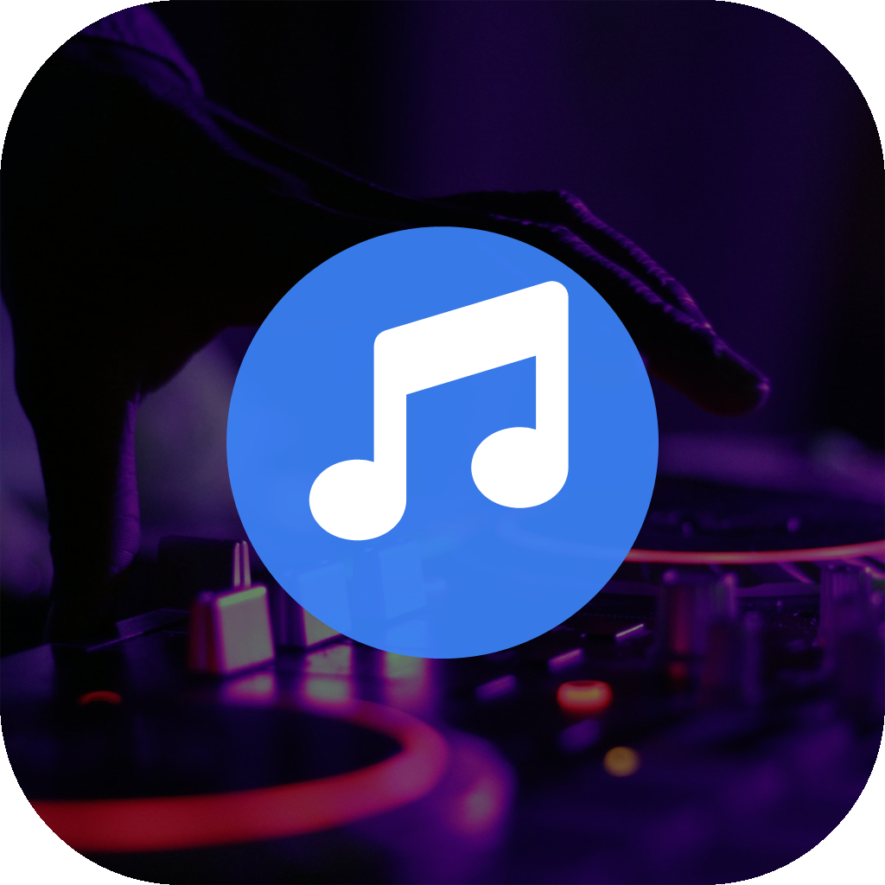

<div align="center">
  
  <h1>HeoMusic for Android</h1>
  <p>界面在 WebView，播放在原生内核 —— 可长期后台运行的音乐客户端</p>
</div>

## 简介

本项目把 [666mingqing6/Music](https://github.com/666mingqing6/Music)（MQ Music / HeoMusic，零构建纯静态音乐站）封装为可安装的 Android 应用。

与常见的「WebView 套壳」不同，这里的**音频播放完全运行在原生前台服务中**：WebView 只负责界面与交互，播放器、播放队列、通知栏、锁屏控制、断线重连全部由原生层实现。因此即使 Activity 或 WebView 被系统回收，音乐仍会继续播放并自动连播。

- 包名：`com.heomusic.player`
- 版本：1.1.0（versionCode 2）
- 最低系统：Android 8.0（API 26）
- 目标系统：Android 15（API 35）
- 安装包：约 1.1 MB

## 功能

- 网易云歌单 + 本地音乐混合播放，播放内核为原生 `MediaPlayer`
- 加权洗牌「平均随机」（Gumbel-top 无放回抽样）、顺序、单曲循环
- 逐行 / 逐字歌词、封面、搜索点播
- 账户登录与播放计数云同步（复用 meting-api + D1，与网页版数据互通）
- 通知栏常驻控制：上一首 / 播放暂停 / 下一首 / 停止
- 锁屏、耳机线控、蓝牙、车机通过 `MediaSession` 控制
- 原生音效：重低音、3D 环绕、沉浸、现场感、流行（`BassBoost` / `Virtualizer` / `Equalizer`）
- 后台持续播放：前台服务 + WakeLock + WifiLock + 断线重连 + 被杀恢复

## 架构

```text
┌──────────────────────────────────────────────────────────────┐
│ MainActivity                                                 │
│  WebView  ←  https://appassets.androidplatform.net/          │
│    ├── index.html / modern.css / all.min.css (本地)          │
│    ├── bridge.js       把 <audio> 代理为原生播放器的镜像      │
│    ├── native-patch.js 接管 loadTrack / 音效 / MediaSession   │
│    └── js/player.js    原有 UI、歌词、洗牌、账户逻辑          │
│         │ JsBridge（@JavascriptInterface）                    │
│         ▼                                                     │
│ MusicService（前台服务，独立于界面存活）                       │
│    ├── MediaPlayer + 播放队列（服务自持，通知栏可切歌）        │
│    ├── MediaSession + MediaStyle 常驻通知                     │
│    ├── AudioFocus / WakeLock / WifiLock                      │
│    ├── NetworkCallback 断线重连 + 指数退避                    │
│    └── 状态持久化 + AlarmManager 重建 + START_STICKY          │
└──────────────────────────────────────────────────────────────┘
          │ HTTPS
          ▼
   meting-api（Cloudflare Worker + D1，独立仓库，无需改动）
```

播放控制流：

1. `player.js` 设置 `<audio>.src` → `bridge.js` 转发给 `JsBridge.playTrack()`
2. `MusicService` 用原生 `MediaPlayer` 加载该 URL 并播放
3. 服务每秒通过 `BridgeHub` 把进度、时长、播放态回推给 WebView
4. 播完时先通知 WebView 按加权洗牌选下一首；若 3 秒内无响应（界面已被回收），服务自行按队列续播

## 安装

1. 下载仓库根目录的 `HeoMusic.apk`，传到手机安装（自签名调试证书，需允许「未知来源」）。
2. 或使用 adb：

```bash
adb install -r HeoMusic.apk
```

首次启动会依次请求：

| 步骤 | 方式 | 说明 |
| --- | --- | --- |
| 通知权限 | 系统弹窗 | 常驻播放通知，Android 13+ 必需 |
| 忽略电池优化 | 系统弹窗 | 防止息屏后进程被冻结 |
| 自启动 / 后台锁定 | 跳转厂商设置页 | 系统不允许应用自行开启，需手动允许 |

第三步对国产 ROM 的实际保活效果影响最大，建议务必开启。

## 构建

项目**不依赖 Gradle / Maven**，使用 Android SDK 命令行工具直接构建，便于在无 Android Studio 的环境复现。

依赖：

- JDK 17
- Android SDK Platform 35（`android.jar`）
- Android Build-Tools 35（`aapt2`、`d8`、`zipalign`、`apksigner`）

```bash
# 1. 准备工具链，目录结构如下
#    _toolchain/jdk/jdk-17/bin
#    _toolchain/sdk/platforms/android-35/android.jar
#    _toolchain/sdk/build-tools/android-15/{aapt2,d8,zipalign,apksigner}
# 2. 构建
bash build.sh
# 产物：HeoMusic.apk
```

`build.sh` 的流程：`aapt2 compile` → `aapt2 link` → `javac` → `d8` → 追加 `classes.dex` → `zipalign` → `apksigner`。

`tools/pack.py` 负责把 `classes.dex` 追加进 APK，并保留 `resources.arsc` 的未压缩状态（Android 11+ 要求）。

图标可用 `tools/make_icon.ps1` 重新生成（Windows PowerShell + System.Drawing）。

## 保活设计

| 层次 | 手段 |
| --- | --- |
| 服务 | `startForeground` + `foregroundServiceType="mediaPlayback"` + `START_STICKY` |
| 通知 | `MediaStyle` 常驻通知，`setOngoing(true)`，不可滑动清除 |
| 系统控制 | `MediaSession`（锁屏 / 耳机 / 蓝牙 / 车机） |
| CPU | `PARTIAL_WAKE_LOCK` |
| 网络 | `WifiLock`（低延迟 / 高性能模式）+ `NetworkCallback` 断线重连 |
| 焦点 | 音频焦点丢失自动暂停，恢复后自动续播 |
| 恢复 | 状态持久化 + `stopWithTask="false"` + `onTaskRemoved` + `AlarmManager` 重建 |
| 续播 | 服务自持播放队列，WebView 被回收后仍自动下一首 |

> 说明：Android 不允许应用无条件长期驻留。厂商强制清理、系统低内存回收、用户手动强行停止均无法绕过。本项目未使用无声播放、双进程互拉、1 像素 Activity 等灰色保活手段。

## 目录结构

```text
.
├── app/src/main
│   ├── AndroidManifest.xml
│   ├── java/com/heomusic/player
│   │   ├── MainActivity.java      WebView 宿主、权限与保活引导
│   │   ├── MusicService.java      原生前台播放服务
│   │   ├── JsBridge.java          WebView → 服务指令
│   │   ├── BridgeHub.java         服务 → WebView 状态回推
│   │   └── RestartReceiver.java   被杀后的恢复广播
│   ├── res                        图标、主题、字符串
│   └── assets/www                 前端资源（含本地 Font Awesome）
├── build.sh                       构建脚本
├── tools
│   ├── pack.py                    打包 dex
│   ├── make_icon.ps1              生成应用图标
│   └── test_bridge.js             bridge.js 行为测试
├── design                         图标源图与 1024 成品
└── DEVELOPMENT_REPORT.md          开发报告
```

## 已知限制

1. **版权与分发**：音源来自网易云非公开接口与自建直链，仅适合个人自用，不建议上架应用商店。
2. **未做真机自动化测试**：构建与静态校验通过，WebView 桥接的运行时行为需在真机确认。
3. **厂商 ROM 差异**：自启动、后台锁定、省电策略的入口和实际效果因品牌与系统版本而异。
4. **音效为近似映射**：Web Audio 的 6 种音效改为原生 `Equalizer` / `BassBoost` / `Virtualizer`，听感与原网页版不完全一致。
5. **调试签名**：仓库内 `build.sh` 使用自签名调试证书（密码 `android`），正式分发请替换为自己的 keystore。

## 许可与致谢

- 前端与后端来自 [666mingqing6/Music](https://github.com/666mingqing6/Music) 与 [666mingqing6/meting-api](https://github.com/666mingqing6/meting-api)，遵循其原仓库许可（MIT）。
- 图标字体：[Font Awesome Free 6.5.1](https://fontawesome.com/)，图标 CC BY 4.0，字体 SIL OFL 1.1。
- 图标背景照片：[Unsplash](https://unsplash.com/)，Unsplash License（免费商用）。
- 本项目仅包含 Android 客户端封装层，不包含任何音乐内容。
